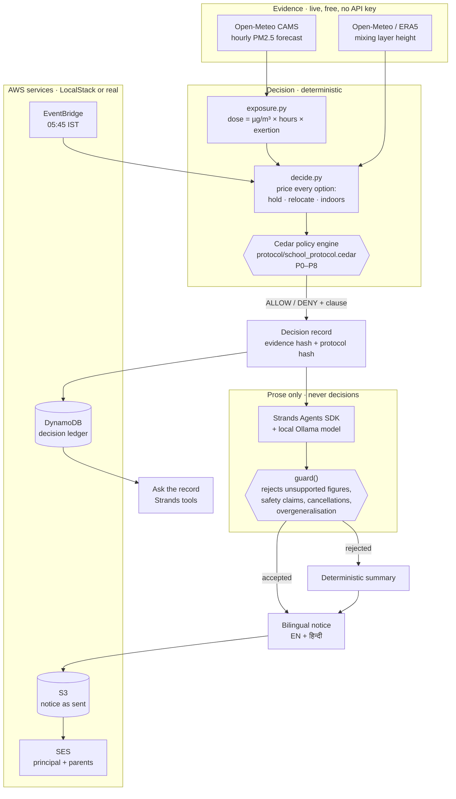

# Saans / साँस

**The bad air day protocol for Indian schools.** It decides what happens to the games
period before 07:00 — from the live forecast, against a policy the principal signed —
and records why, so a parent can still get the answer a month later.

**Live:** <https://saans-air-protocol.lovable.app> · **Code:** this repository

Built for **Environmental Hacks**, Event 02 of the Bharat Builds Tour
(WeMakeDevs × AWS). **Track: Air.**

---

## The problem, with today's real numbers

Every morning someone at a Delhi school has to answer four questions before the gates
open: does assembly happen outside, does the games period happen, do the windows stay
open, who gets a mask. They answer it from a colour on a phone app, or from looking at
the sky.

An AQI number cannot answer it, because an index is a colour for a city for a day. What
a child actually takes in is a **dose**: concentration × time outdoors × how hard they
are breathing. A child at games moves roughly three times the air through their lungs,
so the same reading delivers three times the dose.

Run the numbers for one real Delhi school on a perfectly ordinary October morning —
PM2.5 at 68 µg/m³, which CPCB calls merely *Moderate*, months before the smog season:

| Period | Window | Exertion | Dose | Share of a child's **weekly** WHO budget |
|---|---|---|---:|---:|
| Morning assembly | 07:00–08:00 | ×1 | 32 µg·h | 21% |
| Recess | 10:00–11:00 | ×2 | 67 µg·h | 45% |
| **Games period** | 13:00–14:00 | **×3** | **204 µg·h** | **136%** |
| **One school day** | | | **303 µg·h** | **202%** |

One games period spends more than a child's entire WHO guideline week. A full school
day spends two of them. Nothing about that is visible in the words "AQI: Moderate".

## What Saans does

At 05:45 it pulls the hourly forecast, prices every option for every outdoor period,
puts each one to a policy engine, and publishes a decision per class with the clause
that produced it. Then it writes it to a ledger, renders a bilingual notice, and emails
it to the principal and to the register's parents before 07:00.

It does **not** reach for "cancel" first. For each period it tries, in order:

1. **Hold it outdoors**, if the protocol allows.
2. **Move it into the cleanest hour of the day** — same activity, same exertion,
   different air. This is the recommendation a dashboard never makes.
3. **Take it indoors**, and say plainly that this is a reduction and not an escape:
   an unfiltered shut classroom still admits about half the outdoor particulate.

Decisions are **per class**, because a class carrying children on the respiratory
register is not in the same position as one that is not. On a borderline day you can
watch the protocol keep one class outside and bring another in.

## The rule the whole project is built on

> **No language model decides anything that affects a child's lungs.**

The protocol is [`protocol/school_protocol.cedar`](protocol/school_protocol.cedar) —
the school's circular written in **Cedar**, AWS's open-source policy language. It is
not a prompt. Saans may only hold an activity outdoors if Cedar returns `ALLOW` for
that class, that period and that hour's evidence. A principal can read the file, argue
with a clause, and change a number without touching a line of application code.

The model writes the one sentence at the top of the notice that a parent reads first,
and nothing else — **and its draft is checked before it is used.** The guard
([`saans/agent.py`](saans/agent.py)) rejects a draft that states a figure the decision
record does not support, claims indoors is safe, says a period was "cancelled" when
nothing was cancelled, or flattens a mixed decision into "all classes". Rejected drafts
fall back to a deterministic summary and **the page says so**. This is not theoretical:
the local model's first three drafts during development were all rejected, two of them
for real errors.

## What it is worth, measured on real days

Replayed over real measured air for this location — no modelling of our own:

| Window | School days | Unmitigated | Under protocol | Dose prevented |
|---|---:|---:|---:|---:|
| Last fortnight (Delhi, Oct 2026) | 11 | 19.6 WHO-weeks | 11.4 | **42%** |
| Smog season (Delhi, 3–14 Nov 2025) | 10 | 18.6 WHO-weeks | 9.8 | **47%** |

The number that matters as much as those: on 2026-09-28, with PM2.5 at 29 µg/m³,
**the protocol changed nothing at all.** A protocol that fires on a good day gets
switched off in a fortnight.

## Delhi, school by school

One school proves the protocol works. It does not show the size of the thing.

Saans runs the same protocol across **every school in Delhi that OpenStreetMap has a
name and a location for — 772 real places** (ODbL, in [`data/delhi_schools.json`](data/delhi_schools.json)).
The air genuinely varies: 26 µg/m³ between the cleanest and dirtiest mapped school
this morning, and 55 µg/m³ between the corners of the city. So these are 772 different
decisions, not one decision printed 772 times.

Today's finding, from live data:

> **At all 772 mapped Delhi schools, a single games period costs more than a child's
> entire WHO weekly budget.** the worst of them sit in CPCB *Poor*.

Dose is per child by construction, so this needs no enrolment figure and none is
invented.

## How wrong can the forecast be?

The obvious challenge: Saans acts on a global model's forecast. There is no keyless
ground-truth sensor feed for Delhi to validate against, and quoting a skill score
without one would be dishonest.

So it answers the question that actually matters for a safety tool — does the
*decision* survive the forecast being wrong? [`saans/stability.py`](saans/stability.py)
re-decides every call across **±40% forecast error**, wider than anyone claims for
CAMS:

- **Every games-period call holds across the whole band.** The decision carrying triple
  the dose is the most robust one, which is the right way round.
- Borderline assembly calls flip at −10%, and are reported as **marginal** rather than
  given a confidence they have not earned.

## Built on AWS

The **Build It** path: AWS open-source tooling on a laptop. No AWS account, no card,
no inference bill.

| Component | What it does here |
|---|---|
| **Cedar** (`cedarpy`) | The protocol. Every decision is an authorization request; every denial cites the clause. |
| **Strands Agents SDK** | The agent: four tools over the forecast, the protocol, the ledger and the clause text. Runs against a local Ollama model, so no key and no spend. |
| **LocalStack** | Stands in for four managed services below. The same boto3 calls run unchanged against real AWS — `SAANS_AWS=real` drops the endpoint override. |
| Amazon **DynamoDB** | The decision ledger: every morning's call, its evidence hash and its clauses, keyed by school and date. |
| Amazon **S3** | The notice, stored exactly as it went home. |
| Amazon **EventBridge** | The 05:45 IST rule — `cron(15 0 * * ? *)`. The decision must exist before the principal needs it. |
| Amazon **SES** | Delivery to the principal and to the register's parents. |



## Deploy it to real AWS

The repo also deploys to a live AWS account in one command. Every resource it
creates sits inside AWS's always-free or 12-month-free allowances, which matters
because this is a student project with no budget.

```bash
export AWS_ACCESS_KEY_ID=...  AWS_SECRET_ACCESS_KEY=...
python deploy/aws_deploy.py --region ap-south-1 --sender you@example.com
```

It builds the Lambda package (10.6 MB zipped), creates a least-privilege IAM role,
the DynamoDB ledger, the notices bucket, the 05:45 EventBridge rule and a public
**Lambda Function URL**, then prints the live URL. Re-running updates the function
in place.

| Resource | Free-tier allowance used |
|---|---|
| **Lambda** + Function URL | 1M requests + 400,000 GB-s/month, **always free** (no API Gateway, which is what would cost) |
| **DynamoDB** on-demand | 25 GB, always free |
| **S3** | 5 GB for 12 months |
| **EventBridge** rule | free |
| **CloudWatch Logs** | 5 GB/month ingest, always free |
| **SES** | sandbox — verified identities only |

Two deliberate differences in the deployed runtime, both already designed for:

- **No local model**, so the notice's opening line comes from the deterministic
  summary. The guard's fallback path is simply the normal path here.
- **`/api/city` serves the committed snapshot** rather than re-deriving it from
  ~1,800 throttled requests to a free public API on every cold start.

Tear it all down — a deploy script without a teardown script is how a student ends
up with a bill:

```bash
python deploy/aws_destroy.py --region ap-south-1
```

## Run it locally in two minutes

No AWS account needed.

```bash
python3 -m venv .venv && .venv/bin/pip install -r requirements.txt

# four AWS services, locally (community image, no auth token)
docker run -d --name saans-localstack -p 4566:4566 \
  -e SERVICES=dynamodb,s3,events,ses,sts localstack/localstack:3.7.2

# optional: the agent's prose. Without it, Saans uses the deterministic summary.
ollama pull llama3.1:8b

AWS_ACCESS_KEY_ID=test AWS_SECRET_ACCESS_KEY=test \
  .venv/bin/uvicorn saans.api:app --port 8000
```

Open <http://localhost:8000>. Press **Run the morning job** to decide, draft, write the
ledger, store the notice and send it — the page shows the receipts, not a success
message.

```bash
.venv/bin/python -m pytest          # 54 offline tests
.venv/bin/python -m pytest -m network   # + one live-data test
```

Point it at a different school by changing `LATITUDE` / `LONGITUDE` in
[`saans/school.py`](saans/school.py). Everything else follows.

## The protocol

| | Clause |
|---|---|
| **P0** | The school day runs outdoors as normal unless a clause below applies. |
| **P1** | No vigorous outdoor activity once forecast PM2.5 passes 90, because exertion roughly triples the inhaled dose. |
| **P2** | No outdoor activity at all once forecast PM2.5 passes 120 (CPCB *Very Poor*). |
| **P3** | A class carrying children on the respiratory register stays indoors once PM2.5 passes 60 — India's NAAQS 24-hour standard. |
| **P4** | No outdoor activity when the mixing layer is below 500 m and PM2.5 is already above 60: trapped air gets worse through the session. |
| **P5** | An activity does not stay outdoors when moving it would avoid more than 50 µg·h of inhaled dose. |
| **P6** | Once a class has taken 100 µg·h today, the rest of its outdoor periods come inside. |
| **P7** | Windows shut once PM2.5 passes 60 — the indoor fallback only means something if they are actually shut. |
| **P8** | Masks to the respiratory register once PM2.5 passes 90, and to every child once it passes 120. |

### One design decision worth explaining

An earlier version gated P5 and P6 on WHO's weekly budget directly. It sounds more
rigorous and it is useless: Delhi spends that budget by Tuesday, so every clause fired
for every class every day and the protocol stopped discriminating entirely. The WHO
figure is kept as the **yardstick impact is reported against**. What the protocol
**enforces** is avoidable dose — the part of today's exposure the school can still
choose not to take. That is the difference between a true statement and an operational
tool.

## What is real and what is not

- **Real:** all air and weather data, live and historical, from Open-Meteo's CAMS and
  ERA5 feeds — free, no API key. The location (28.7045, 77.1550, Shalimar Bagh, ~4 km
  from DTU). CPCB breakpoints, India's NAAQS 24-hour standard, the WHO 2021 guideline.
  The Cedar evaluation, the AWS calls, the dose arithmetic.
- **Synthetic and labelled as such:** the roster — four classes, 183 children, six on
  the respiratory register. Inventing health records for a named real school would be
  dishonest, and no logic depends on the names being real.
- **Approximations, stated:** exertion multipliers (×1 / ×2 / ×3) are a standard
  minute-ventilation ratio, not a per-child measurement. Indoor infiltration is taken
  as 0.5 for a shut unfiltered room. Both are single constants in
  [`saans/school.py`](saans/school.py).

## Limitations

- Forecast, not sensor. CAMS is a global model at coarse resolution; a school beside a
  construction site or a waste fire will be worse than it says. A ₹3,000 PM sensor on
  the roof is the obvious next input, and the dose maths does not change.
- Saans has no view inside the classroom. Indoor dose is modelled from outdoor
  concentration and an infiltration constant.
- The relocation step assumes periods can actually be rescheduled within the day.
- Nothing here is medical advice, and the notice says so by never claiming indoors is
  safe.

## AI tools used

Per the tour rules: this project was built with **Claude Code (Claude Opus 5)** as a
pair-programming tool across the hackathon window. The runtime model — the one in the
product — is **llama3.1:8b running locally via Ollama**, used only to draft the
notice's opening sentence, behind the guard described above.

## Licence

Apache-2.0.
